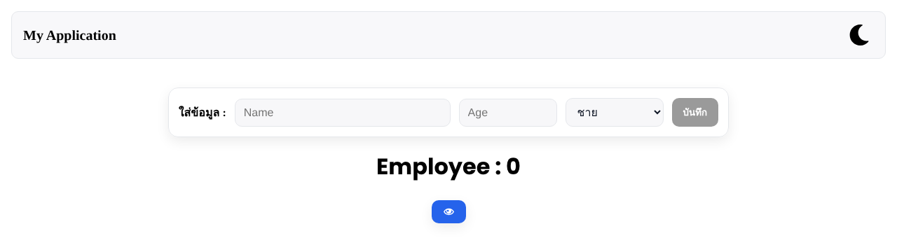

# Employee List — React State & Persistence

**A small React app for adding, viewing and removing employees, with data and the light/dark theme saved in `localStorage`.**




## Features

- Add employees (name, age, gender); the Save button stays disabled until the form is complete
- Delete employees, show/hide the list, and a live employee count
- **Persistence:** the employee list and the light/dark theme survive page reloads (`localStorage`)
- Unique IDs with `crypto.randomUUID()`

```
src/
  App.jsx                    State, persistence, theme
  components/Header.jsx      Title and theme toggle
  components/AddForm.jsx     Controlled form with validation
  components/PersonList.jsx  List with show/hide toggle
  components/User.jsx        One employee row with delete
```

## Run

```bash
git clone https://github.com/tawan230666/My-Project-React-1.git
cd My-Project-React-1
npm install
npm run dev
```

---

**Author:** Tawan Tiphkun (ธาวัน ทิพคุณ), [@tawan230666](https://github.com/tawan230666), Software Engineering, RMUTL Chiang Mai
